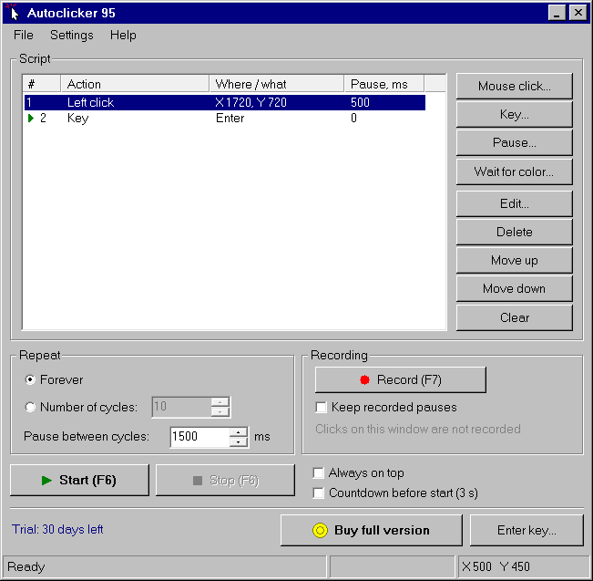
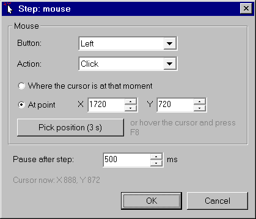
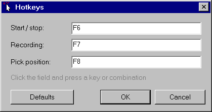
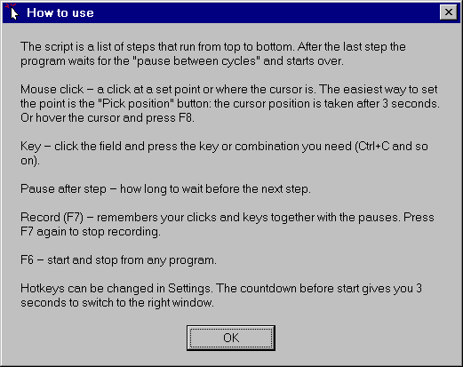

# Autoclicker 95

A Windows 95 style auto clicker and macro recorder. Build a scenario of mouse clicks, key presses and pauses by hand or record it, then repeat it forever or a set number of times.

Website: https://autoclicker95.pages.dev

## Download

Get the latest `Autoclicker95-<version>-portable.zip` from the [Releases page](https://github.com/jojoqwerty/autoclicker95/releases/latest), unpack it and run `AutoClicker95.exe`. There is no installer and no dependencies.

## Features

- Steps: mouse click (left, right, middle, double, hold, release) at a point or at the cursor, key or key combination, pause
- Wait for color: pause the scenario until a pixel on the screen reaches a chosen color (full version bonus)
- Recording of clicks and key presses with their delays
- Global hotkeys: F6 start/stop, F7 record, F8 pick a position (configurable)
- Countdown before start, infinite or counted cycles
- Interface in 11 languages: English, Russian, Ukrainian, German, French, Italian, Spanish, Portuguese, Japanese, Korean, Chinese
- Single file of about 150 KB, plain Win32, low memory use

| Scenario editor | Hotkeys | Help |
|---|---|---|
|  |  |  |

## Trial and full version

Autoclicker 95 is shareware. It runs fully functional for 30 days. After that, buy the full version and enter your license key in the program. The full version also includes the "Wait for color" step.

Buy the full version: https://autoclicker95.pages.dev/#buy

## System requirements

- Windows 10 or Windows 11, 64-bit
- No installer: unpack the zip and run the program
- About 150 KB of disk space, about 2 MB of memory
- No administrator rights needed. To click inside programs running as administrator, start Autoclicker 95 as administrator too.

## FAQ

**My antivirus flags the file. Is it safe?**
Auto clickers send synthetic mouse and keyboard input and register global hotkeys, which some antivirus engines treat as suspicious behavior. The program has no network code and installs nothing. The file is a small executable without a code-signing certificate, so reputation-based engines may warn about it at first. Scan it on VirusTotal or report the false positive to your antivirus vendor.

**Windows SmartScreen says the app is not recognized.**
This appears for new files without a signature. Choose "More info", then "Run anyway".

**Does it work in programs running as administrator?**
Yes, if you also start Autoclicker 95 as administrator.

**Does it work in games?**
Some games and protected programs block synthetic input. Autoclicker 95 does not bypass such protection.

## License

Proprietary shareware, see https://autoclicker95.pages.dev/eula. This repository contains no source code.

&copy; 2026 Igor Tereshkov, Expatus. All rights reserved.
